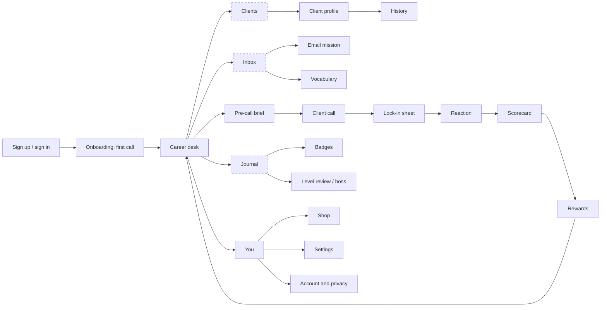
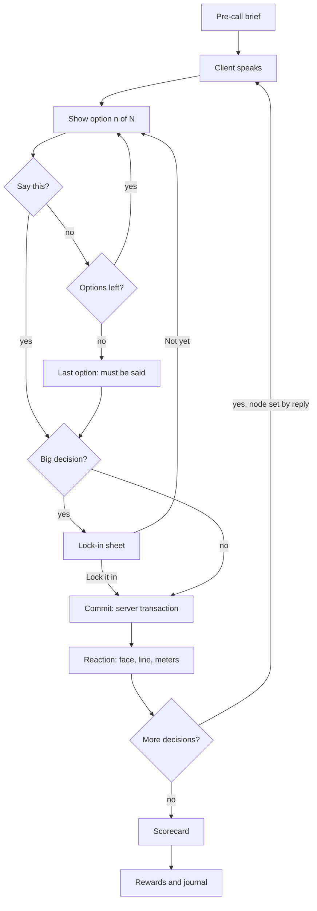

# CareerVerse: Design Brief

**Status:** Developer recommendation (visual direction), v1 · 2026-10-26
**Source canvas:** CareerVerse — Game Screens (pages: Mobile, Desktop, Maps)
**Runnable reference:** `design/prototype/index.html` (responsive, interactive, no AI)
**Use:** Build every remaining screen from this file. When a screen isn't drawn on the canvas, compose it from the tokens, components and templates below. Don't invent new colours, radii or type sizes.

---

## 1. Direction in one paragraph

Bright, young, corporate. A white, airy workspace that looks like a modern professional tool (think a good fintech or productivity app), made playful by **people, not decoration**: every client owns a pastel colour that follows them everywhere, and their portrait reacts to what you say. One cobalt accent marks progress. Big serif headlines speak to the player in plain sentences built from real game state ("Morning, Alex. Marcus needs his COI by 3:00 PM."). No gradients, glows, emoji or neon.

**Design principles**
1. The client is the colour. Pastel tints identify people; chrome stays neutral.
2. Progress is the accent. Cobalt only on XP, trust and 7C ratings, plus at most one control.
3. Say it in a sentence. Each screen opens with one headline that states the situation.
4. Numbers are type, not tiles. Large regular-weight figures; no icon bubbles.
5. Honest states. Never show "Saved" before the server confirms. Never imply undo.

---

## 2. Tokens

```css
:root {
  /* Ground and surfaces */
  --ground:   #FFFFFF;   /* page / sheet */
  --chrome:   #F4F6FA;   /* app frame, top bar, panels */
  --raised:   #FFFFFF;   /* row cards inside panels */
  --track:    #E3E7EF;   /* progress tracks, dividers on chrome */
  --border:   #E6E9F0;   /* 1px card edges */
  --rule:     #EEF1F6;   /* dividers inside white cards */
  --off:      #D5DAE3;   /* inactive pips, empty segments */

  /* Ink */
  --ink:      #14161C;   /* text, primary button fill */
  --ink-2:    #3D4250;   /* secondary body text */
  --muted:    #5B6170;   /* labels, meta (4.5:1 on chrome) */

  /* Accent: progress only */
  --accent:   #2459E0;   /* cobalt */

  /* Meaning */
  --positive: #1E7A4C;   --pill-pos-bg: #DCFAE5;  --pill-pos-ink: #04250E;
  --warning:  #92400E;   --pill-warn-bg: #FFF4D6; --pill-warn-ink: #7A3E00;
  --negative: #B42318;   --pill-neg-bg: #FDECEA;  --pill-neg-ink: #7A1D14;
  --neutral-pill-bg: #E3E7EF; --neutral-pill-ink: #3D4250;
  --anger:    #C2410C;   /* the anger meter only */

  /* Client identity tints (stable per client, never used as data colours) */
  --tint-blue:  #DCE8FF; --tint-blue-ink:  #1F3F8F;   /* e.g. Marcus */
  --tint-coral: #FFE3DA; --tint-coral-ink: #8A2E12;   /* e.g. Dana */
  --tint-mint:  #D6F3E6; --tint-mint-ink:  #0D5A3A;   /* e.g. Priya */
  --tint-butter:#FFF0C2; --tint-butter-ink:#7A3E00;   /* rewards, badges, rules */
  /* More clients: pick hues at least 60° apart, no violet. Candidates: sky #D9F1FB, sand #F3E7D3 */

  /* Shape */
  --radius-panel: 22px;   --radius-card: 14px;   --radius-sheet: 26px;
  --radius-pill: 999px;   --radius-frame: 16px;

  /* Space (4px base) */
  --gap: 16px;  --pad-panel: 20px;  --pad-page-mobile: 16px;  --pad-page-desktop: 24px;

  /* Elevation: only things that float */
  --shadow-float: 0 2px 8px rgba(20,22,28,.06);      /* dialogue bubble */
  --shadow-sheet: 0 -8px 24px rgba(20,22,28,.12);    /* bottom sheet */
  --shadow-dialog: 0 16px 40px rgba(20,22,28,.18);   /* desktop modal */
  --scrim: rgba(20,22,28,.40);

  /* Type */
  --font-sans:  "Instrument Sans", Inter, system-ui, sans-serif;
  --font-serif: "Instrument Serif", Georgia, serif;
}
```

Fonts (Google Fonts): `Instrument Sans` 400/500/600 and `Instrument Serif` regular + italic.

---

## 3. Typography

| Role | Mobile | Desktop | Face / weight | Notes |
|---|---|---|---|---|
| Screen headline (greeting, verdict, client name) | 32/1.08 | 48/1.05 | Serif 400 | One per screen. A sentence from game state. Tracking −0.01em. |
| Sheet / modal title | 28/1.1 | 32/1.1 | Serif 400 | "Say this to Marcus?" |
| Section title | 14/600 | 14/600 | Sans | Sentence case, never uppercase. Count in grey after it. |
| Card title | 19/600 | 28/600 | Sans | Next-call headline. Tracking −0.01em. |
| Choice text | 18/1.45 | 20/1.45 | Sans 400 | In curly quotes. |
| Dialogue line | 16/1.45 | 18/1.45 | Sans 400 | |
| Body | 15/1.5 | 15/1.5 | Sans 400 | Coaching, descriptions. |
| UI / rows | 14 | 14 | Sans 400–600 | |
| Label / meta | 12–13 | 12–13 | Sans 400 | `--muted`. Never below 12. |
| Big figure | 24–36 | 32–40 | Sans 400 | `tabular-nums`. Unit as a smaller grey suffix: `84 /100`. |
| Quote / client thought | 24/1.2 | 26/1.2 | Serif italic | |

Rules: max two faces. The serif only for headlines, titles and client thoughts. Every number uses `font-variant-numeric: tabular-nums`.

---

## 4. Colour rules

- **Accent budget:** cobalt appears on progress (XP bar, trust meter, 7C segments, current choice pip, history dots for calls) and nowhere in navigation or buttons.
- **Primary action:** near-black pill (`--ink`) with white text. One per view. Secondary: `#E3E7EF` pill with ink text.
- **Good / bad, not up / down:** a change is green when it helps the player (trust up, anger down) and red when it hurts. Zero change shows nothing.
- **Status always has a word:** On track (green pill), Watch (amber pill), At risk (red pill). Never colour alone.
- **Client tints** fill that client's hero panel, call stage, avatar circle and next-call card. Their darker ink colour is for text on the tint.
- **Mood on the call stage:** the stage tint changes with the client's reaction: blue (neutral), mint (relieved), coral (frustrated). Always paired with the portrait's expression and an `aria-label`.

---

## 5. Layout

### Breakpoints
| Band | Width | Shell |
|---|---|---|
| Phone | ≤ 640 | Top bar 56px + bottom nav (4 tabs). Panels stack. |
| Tablet | 641–1100 | Top bar; panels two-up where each stays ≥ 340px. |
| Desktop | ≥ 1101 | L-frame: 228px sidebar on `--chrome`, content on a white sheet inset 8px right/bottom, radius 16, 1px border. |

### Mobile shell
- Top bar 56px on `--chrome`: back/pause (44px hit), title + subline, one status or action on the right.
- Page padding 16px. Panel gap 16px. Bottom nav: Desk, Clients, Inbox, Journal. Active tab = `#EEF1F6` pill + ink label; others grey.
- Primary button full width, 48–52px tall, near the thumb.

### Desktop shell
- Sidebar: product mark + name, nav rows 36px (active row `#E3E7EF`, ink, 600), player card at the bottom.
- Sheet content: centred column, max 1100px, top padding 56px for headline screens.
- Rows of panels use flex-wrap with spans that line up (4 × ¼, then ¾ + ¼, then ½ + ½).
- Call screen: three columns: brief (280) · stage + choice (fluid) · relationship and progress (260).

---

## 6. Components

| Component | Spec |
|---|---|
| **Panel** | `--chrome` fill, radius 22, padding 20, no border, no shadow. Title row: section title left, "View all" or meta right. |
| **Row card** | White, 1px `--border`, radius 14, height 63px (52 for compact lists). Avatar or label left, two-line text, one pill or figure right. |
| **KPI strip** | One container (`--chrome` or white with border), split by 1px dividers into 2–4 cells. Label 12–13 grey above a 22–40px figure. No icons. |
| **Pill / chip** | Height ~22, radius 999, 12px/500, pale tint + dark ink of the same hue. `white-space: nowrap`. One status pill per row. |
| **Primary button** | Pill, `--ink` fill, white 15/600, min height 44 (desktop) / 48 (mobile). Optional trailing arrow icon. |
| **Secondary button** | Pill, `#E3E7EF`, ink text. Disabled: `#EEF1F6` fill, `#8A90A0` text. |
| **Progress bar** | 6–8px track `--track`, radius 999, fill `--accent`. Label and figure above. |
| **Relationship meter** | Label left, `delta value/10` right, 6px bar below. Trust = accent, Respect = ink, Anger = `--anger`. |
| **7C row** | Name · 3-segment bar (filled with accent per level) · level pill (Strong green, Good neutral, Needs work amber). Desktop adds a one-line reason. |
| **Dialogue bubble** | White, 1px border, radius 18, `--shadow-float`, overlaps the stage bottom by 18–24px. Speaker name 12/600 in the client's ink colour. |
| **Call stage** | Client tint, radius 22, 236px (mobile) / 320px (desktop) tall, portrait anchored bottom. Mobile places meters in a white card inside the stage. |
| **Choice card** | Panel. Header "Your reply · option n of N" + pips (current 20×6 accent, past grey, future `--off`). Quote text. Buttons: Next option (secondary) + Say this (primary). Hint line under. |
| **Lock-in sheet** | Mobile: bottom sheet, radius 26 top, handle, serif title, quoted reply on `--chrome`, consequence sentence ending in bold "can't be taken back", buttons Not yet / Lock it in. Desktop: centred modal, max 520px. |
| **Tabs** | Segmented pill on `--chrome`; active segment white with 1px border and ink text. Never accent-filled. |
| **Timeline** | 10px dot (accent for calls, grey for system events), 1px rail, when · kind in grey, title 15/600, detail 14. Footer note: history is permanent. |
| **Coaching block** | Three labelled paragraphs: What worked (green label), Try next time (amber), Why it mattered (blue ink). Then a white "Rule of thumb" card with a serif line. |
| **Badge** | Round medal: white ring with ink stroke, butter centre, ink pictogram, two ribbon tails (cobalt + navy). Shown on a full butter field. |
| **Avatar** | Circle, client tint, initials 600 in tint ink. Sizes 32 / 38 / 44 / 96. |
| **Product mark** | Cobalt speech bubble with a white upward chevron (talk + career climb). 28px in shells. |

---

## 7. Character portraits

- Flat vector busts, no outlines, built on a 64×64 grid; shown at 64, 104, 150, 208–300px.
- Each recurring character needs: distinct silhouette (hair shape), skin tone, clothing colour, and their tint as background.
- **Required expressions per character:** neutral, worried, pleased, relieved, frustrated (5). Expressions change only brows and mouth so they swap without layout shift.
- Every portrait carries `role="img"` and an `aria-label` describing the mood ("Marcus looks relieved").
- Placeholder art on the canvas is a stand-in. Commission or draw the final set in this exact flat style.

---

## 8. Icons

Outline icons, 1.6–2px stroke, 16px in desktop nav, 20px in mobile nav, 16–18px inline, grey (`--muted` / `--ink-2`). One set throughout (Lucide matches well). Never inside coloured circles or squares. Icon-only buttons need an `aria-label`.

---

## 9. States

| State | Treatment |
|---|---|
| Saving | Grey dot + "Saving…" in the top bar. Buttons that commit are disabled. |
| Saved | Green dot + "Saved" only after the server confirms the write. |
| Offline / reconnecting | Amber pill "Reconnecting" in the top bar; choices disabled with the reason in the hint line. |
| Uncertain commit | Full-width notice in the choice area: "Checking whether your reply was saved…" Fetch server state before allowing another tap. |
| Error | Inline red-ink sentence with a retry action. Never blames the player. |
| Empty | Keep the panel frame; one sentence in the trade's words plus the next action ("No emails yet. Your first one arrives after Marcus's call."). No illustrations. |
| Loading | Skeleton rows in `--chrome` for anything over 1s; nothing under 300ms. |
| Locked feature | Hidden until unlocked (progressive navigation), not shown greyed out. |

---

## 10. Motion

Durations 150–250ms for UI, 350–500ms for meter and stage-tint changes, ~1.1s for the XP fill on the reward screen. Easing `cubic-bezier(.2,.8,.2,1)`. Animate only opacity, transform, width of bars and background colour. Every animation has a `prefers-reduced-motion: reduce` fallback with no movement. Nothing blocks reading or choosing.

**Lottie animations** (files in `/lottie`, catalogue in `lottie/README.md`, rendered with `lottie-web` light SVG player): `success-check` (reply saved), `saving-dots` (pending write), `call-pulse` (next call waiting), `badge-burst` + `confetti` (badge earned, once), `xp-spark` (XP gained). Lottie is decoration on top of an honest UI state: the text label must always say the same thing without the animation.

---

## 11. Accessibility checklist

- Text contrast ≥ 4.5:1 (12px labels included); large figures ≥ 3:1.
- Touch targets ≥ 44px. Visible focus: 2px cobalt outline, 2px offset.
- Real `<button>`, `<a>`, `<input>` + `<label>`; dialogs use `role="dialog"` + `aria-modal`; tabs use `role="tab"` + `aria-selected`.
- Status and deltas never by colour alone (word, sign or icon too).
- Text resizes to 200% without losing actions. No time limits on reading or choosing.

---

## 12. Voice in the UI

Plain, warm, specific. Use the trade's words: COI, endorsement, carrier, underwriter, renewal. Buttons are verbs: "Take the call", "Say this", "Lock it in", "See how you did", "Collect rewards". Coaching never shames: say what worked first. Never "OK", "Submit" or "Proceed".

---

## 13. Don't

Gradients, glows, glass, neon, dark navy themes, emoji, violet or indigo, icons in tinted bubbles, sparklines on numbers, uppercase tracked labels, accent-coloured nav or tabs, a "Saved" that the server hasn't confirmed, anything that suggests a decision can be undone, and coloured status without a word.

---

## 14. Page inventory

| Page | Mobile | Desktop | Build from |
|---|---|---|---|
| Career desk | Drawn | Drawn | — |
| Client call + lock-in | Drawn (playable) | Drawn (playable) | — |
| Scorecard | Drawn | Drawn (includes rewards) | — |
| Rewards | Drawn | In scorecard right column | — |
| Client profile + history | Drawn | Drawn (list + detail) | — |
| Sign up / sign in | To design | To design | Centred 400px column, serif headline, labelled inputs, near-black primary. |
| Onboarding | To design | To design | Call screen template with a coach character; teach "one reply at a time" with a no-stakes decision first. |
| Pre-call brief | To design | Left column of desktop call | Panel stack: goal, what you know (timeline), preferences, thought. |
| Inbox | To design | To design | Row-card list; desktop list + detail split. |
| Email mission | To design | To design | Email in a white card; highlight-able facts; choice card for the reply. |
| Vocabulary | To design | To design | Row cards: term, plain meaning, example from a past call. |
| Career journal | To design | To design | Timeline component, grouped by day. |
| Badges | To design | To design | Grid of medals on butter tiles; locked badges hidden, earned ones show evidence. |
| Level review / boss | To design | To design | Headline + gate list (from desktop desk) + the boss call on the call template. |
| Shop | To design | To design | Row cards with price in coins; consumable limits shown beside the button. |
| Settings, account | To design | To design | Label column above panel on mobile; text size, reduced motion, reminders (opt-in), export, delete. |

---

## 15. Maps (text versions of the canvas)

### Pages


### Question flow in one call

Note: "Big decision?" assumes the tiered-confirmation proposal from the earlier review. Until it's approved, every decision goes through the lock-in sheet (current confirmed requirement).

### Qualifiers (placeholder values: open decisions 3–6)
| Qualifier | Inputs | Rule | Outcome |
|---|---|---|---|
| Promotion | XP, calls, health, incidents, boss | All gates: XP 500, 9/9 calls, health Good+, no severe incident, boss passed | Promoted, or stay with missing gates shown |
| Account status | Trust, respect, anger, deadlines, incidents, importance | Weighted score; severe incident → At risk | On track 70+ · Watch 40–69 · At risk <40 |
| Score cap | Critical flag on chosen reply | Business score capped at 40 | Reason on scorecard + incident logged |
| Client thoughts | Trust, EI, level | T1 at trust 6; T2 at trust 8 + EI Good | Clue on profile, never the answer |
| Rewards | Base, performance, badge evidence | XP = base + bonus; badges need evidence | Awarded once per call |
| Streak | Daily activity, freezes | 1 qualifying activity/day; freeze covers 1 day; hold max 2 | +1, kept, or reset |
| Feature unlocks | Progress events | Clients after 1st scorecard; Inbox after call 2; Journal after 1st big decision; Shop after L1 review | New tab with a one-line intro |

---

## 16. Open items for the owner

1. Approve or replace the cobalt accent (the design-taste kit's default was deep teal `#1B6E66`).
2. Approve the tiered lock-in sheet (proposal) or keep a confirmation on every decision.
3. Final character art: commission the 5-expression set per character in the flat style above.
4. All thresholds in §15 are placeholders until playtesting.

*Record approvals in `07_DECISION_LOG_AND_RND.md`.*
